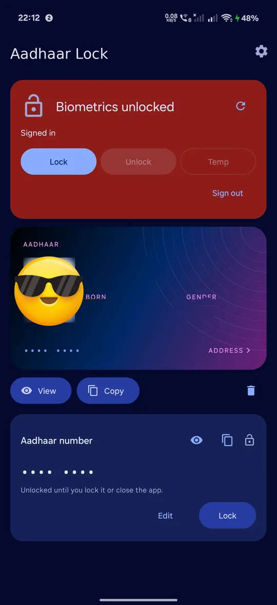
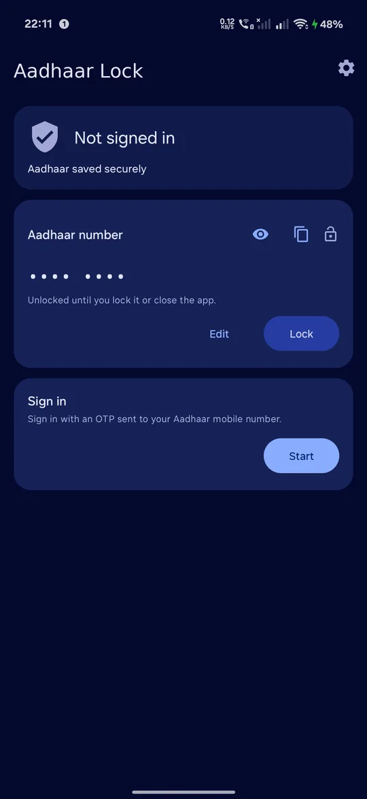
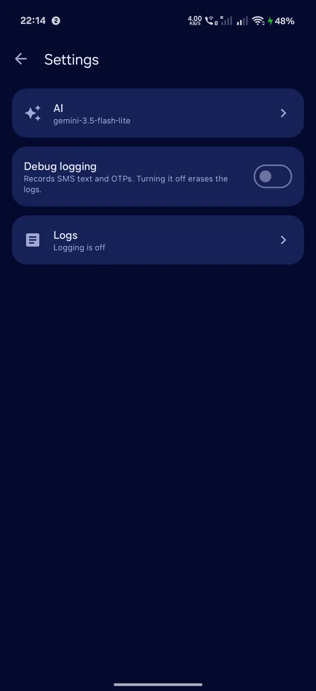
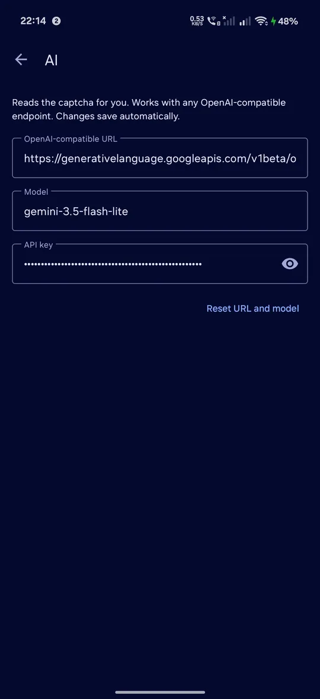

# Aadhaar Lock

Lock and unlock your Aadhaar biometrics from your phone.

<p>
  
  
  
  
</p>

- Lock, unlock or temporarily unlock biometrics
- Data stored using hardware encryption
- OTP needed the first time and when changing the lock
- Your Aadhaar card, offline, behind your fingerprint
- Hidden by default. Tap View to see it, tap Copy to copy it
- No mAadhaar app needed

Unofficial. Not affiliated with UIDAI.

## Download

Get the APK from [Releases](https://github.com/S4tyendra/aadhaar-lock/releases). Not sure which one? Take `universal`.

Android 12 or newer.

## Features

**Messages:** OTPs fill in from SMS. If Android hides the message, type it.

**AI:** Add an API key in Settings and the captcha solves itself. Any OpenAI-compatible provider works. No key? Type it.

**Root:** Rooted phone? Turn on Read SMS with root in Settings. OTPs fill in even when Android hides them. Off by default.

## Build it yourself

You need JDK 17 and Android SDK 37.

```sh
git clone https://github.com/S4tyendra/aadhaar-lock
cd aadhaar-lock
./gradlew assembleDebug
```

APK lands in `build/outputs/apk/debug/`.
